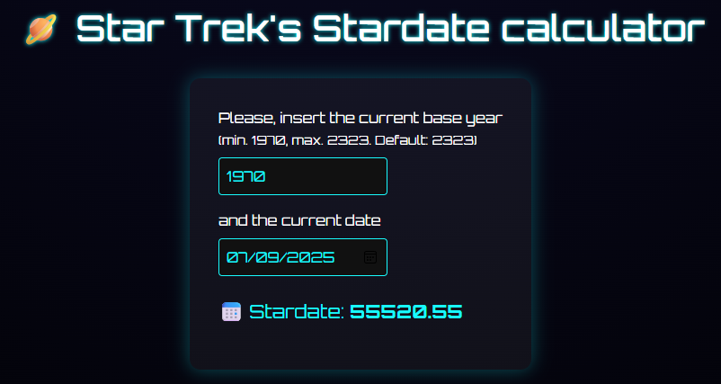

<!-- PROJECT SHIELDS -->
[![Contributors][contributors-shield]][contributors-url]
[![Forks][forks-shield]][forks-url]
[![Stargazers][stars-shield]][stars-url]
[![Issues][issues-shield]][issues-url]
[![MIT License][license-shield]][license-url]

<!-- PROJECT LOGO -->
<br />
<p align="center">
  <a href="https://github.com/s9yk3r/tng-stardate-calculator">
    
  </a>

<h3 align="center">Star Trek TNG Stardate Calculator</h3>

  <p align="center">
    A lightweight, futuristic web application to calculate Star Trek: The Next Generation (TNG) stardates from any calendar date.
    <br />
    <br />
    <a href="https://s9yk3r.github.io/tng-stardate-calculator/"><strong>View Live Demo »</strong></a>
    <br />
    <br />
    <a href="https://github.com/s9yk3r/tng-stardate-calculator/issues">Report Bug</a>
    ·
    <a href="https://github.com/s9yk3r/tng-stardate-calculator/issues">Request Feature</a>
  </p>
</p>

<!-- TABLE OF CONTENTS -->
<details open="open">
  <summary>Table of Contents</summary>
  <ol>
    <li>
      <a href="#about-the-project">About The Project</a>
      <ul>
        <li><a href="#built-with">Built With</a></li>
      </ul>
    </li>
    <li>
      <a href="#getting-started">Getting Started</a>
      <ul>
        <li><a href="#prerequisites">Prerequisites</a></li>
        <li><a href="#installation">Installation</a></li>
      </ul>
    </li>
    <li><a href="#contributing">Contributing</a></li>
    <li><a href="#license">License</a></li>
    <li><a href="#contact">Contact</a></li>
  </ol>
</details>

<!-- ABOUT THE PROJECT -->
## About The Project

<p align="center">
  
</p>

A single-page Vue.js utility that calculates TNG-era stardates dynamically. Users can adjust both the base year and the calendar date to convert dates into standard 5-digit Star Trek stardates with decimal precision.

### Built With

* [Vue.js](https://vuejs.org/)
* [Vite](https://vite.dev/)
* [Bootstrap](https://getbootstrap.com)
* [Sass](https://sass-lang.com/)

<!-- GETTING STARTED -->
## Getting Started

To get a local copy up and running, follow these steps.

### Prerequisites

Make sure you have Node.js installed (LTS version recommended).
* npm
  ```sh
  npm install npm@latest -g
