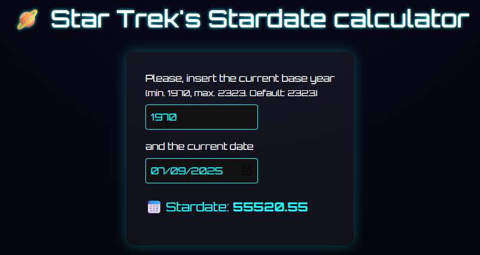

<!-- PROJECT SHIELDS -->
[![Contributors][contributors-shield]][contributors-url]
[![Forks][forks-shield]][forks-url]
[![Stargazers][stars-shield]][stars-url]
[![Issues][issues-shield]][issues-url]
[![MIT License][license-shield]][license-url]

<!-- PROJECT LOGO -->
<br />
<p align="center">
  <a href="https://github.com/s9yk3r/tng-stardate-calculator">
    
  </a>

<h3 align="center">Star Trek TNG Stardate Calculator</h3>

  <p align="center">
    A lightweight, futuristic web application to calculate Star Trek: The Next Generation (TNG) stardates from any calendar date.
    <br />
    <br />
    <a href="https://s9yk3r.github.io/tng-stardate-calculator/"><strong>View Live Demo »</strong></a>
    <br />
    <br />
    <a href="https://github.com/s9yk3r/tng-stardate-calculator/issues">Report Bug</a>
    ·
    <a href="https://github.com/s9yk3r/tng-stardate-calculator/issues">Request Feature</a>
  </p>
</p>

<!-- TABLE OF CONTENTS -->
<details open="open">
  <summary>Table of Contents</summary>
  <ol>
    <li>
      <a href="#about-the-project">About The Project</a>
      <ul>
        <li><a href="#built-with">Built With</a></li>
      </ul>
    </li>
    <li>
      <a href="#getting-started">Getting Started</a>
      <ul>
        <li><a href="#prerequisites">Prerequisites</a></li>
        <li><a href="#installation">Installation</a></li>
      </ul>
    </li>
    <li><a href="#contributing">Contributing</a></li>
    <li><a href="#license">License</a></li>
    <li><a href="#contact">Contact</a></li>
  </ol>
</details>

<!-- ABOUT THE PROJECT -->
## About The Project

<p align="center">
  
</p>

A single-page Vue.js utility that calculates TNG-era stardates dynamically. Users can adjust both the base year and the calendar date to convert dates into standard 5-digit Star Trek stardates with decimal precision.

### Built With

* [Vue.js](https://vuejs.org/)
* [Vite](https://vite.dev/)
* [Bootstrap](https://getbootstrap.com)
* [Sass](https://sass-lang.com/)

<!-- GETTING STARTED -->
## Getting Started

To get a local copy up and running, follow these steps.

### Prerequisites

Make sure you have Node.js installed (LTS version recommended).
* npm
  ```sh
  npm install npm@latest -g
  ```

### Installation

1. Clone the repo
   ```sh
   git clone https://github.com/s9yk3r/tng-stardate-calculator.git
   ```
2. Move into the project folder
   ```sh
   cd tng-stardate-calculator
   ```
3. Install dependencies
   ```sh
   npm install
   ```
4. Start the dev server
   ```sh
   npm run dev
   ```
   Vite will print the local URL (usually `http://localhost:5173`) — open it in your browser and you're good to go.

### Build

To generate a production-ready bundle:

```sh
npm run build
```

The output is written to the `dist/` folder and can be deployed to any static hosting service (GitHub Pages, Netlify, Vercel, etc.). To preview the production build locally:

```sh
npm run preview
```
<!-- CONTRIBUTING -->
## Contributing

Contributions are what make the open source community such an amazing place to learn, inspire, and create. Any contributions you make are **greatly appreciated**.

1. Fork the Project
2. Create your Feature Branch (`git checkout -b feature/AmazingFeature`)
3. Commit your Changes (`git commit -m 'Add some AmazingFeature'`)
4. Push to the Branch (`git push origin feature/AmazingFeature`)
5. Open a Pull Request

If you find a bug or have an idea for a new feature, feel free to [open an issue](https://github.com/s9yk3r/tng-stardate-calculator/issues) first.

<p align="right">(<a href="#top">back to top</a>)</p>

<!-- LICENSE -->
## License

Distributed under the MIT License. See `LICENSE` for more information.

<p align="right">(<a href="#top">back to top</a>)</p>

<!-- CONTACT -->
## Contact

s9yk3r - s9yk3r@pm.me

Project Link: [https://github.com/s9yk3r/tng-stardate-calculator](https://github.com/s9yk3r/tng-stardate-calculator)

<p align="right">(<a href="#top">back to top</a>)</p>

<!-- MARKDOWN LINKS & IMAGES -->
<!-- https://www.markdownguide.org/basic-syntax/#reference-style-links -->
[contributors-shield]: https://img.shields.io/github/contributors/s9yk3r/tng-stardate-calculator.svg?style=for-the-badge
[contributors-url]: https://github.com/s9yk3r/tng-stardate-calculator/graphs/contributors
[forks-shield]: https://img.shields.io/github/forks/s9yk3r/tng-stardate-calculator.svg?style=for-the-badge
[forks-url]: https://github.com/s9yk3r/tng-stardate-calculator/network/members
[stars-shield]: https://img.shields.io/github/stars/s9yk3r/tng-stardate-calculator.svg?style=for-the-badge
[stars-url]: https://github.com/s9yk3r/tng-stardate-calculator/stargazers
[issues-shield]: https://img.shields.io/github/issues/s9yk3r/tng-stardate-calculator.svg?style=for-the-badge
[issues-url]: https://github.com/s9yk3r/tng-stardate-calculator/issues
[license-shield]: https://img.shields.io/github/license/s9yk3r/tng-stardate-calculator.svg?style=for-the-badge
[license-url]: https://github.com/s9yk3r/tng-stardate-calculator/blob/main/LICENSE.txt

